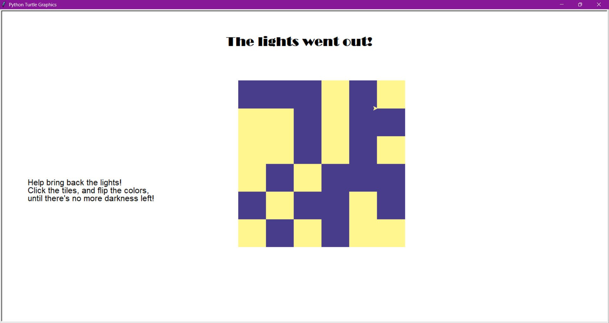

# The Lights Went Out!

A Lights Out style puzzle written in Python with the `turtle` module. The board is a 6x6 grid of dark and yellow tiles. Clicking a tile flips its color and the colors of the tiles directly next to it. Bring the lights back by making every tile yellow.



## Instructions

1. The game starts with a random pattern of dark blue and yellow tiles.
2. Click on any tile. That tile and its neighbours above, below, left and right (the ones that exist, so corner and edge tiles flip fewer tiles) switch color.
3. Keep clicking until every tile is yellow. When there's no more dark blue tiles left, you have won.

## Requirements

- Python 3
- `turtle` (included with Python; on some Linux systems you may need to install Tk, e.g. `sudo apt install python3-tk`)

No other packages are needed.

## Running

```
luminite_craciun.py
```


## How it works

- The board is an `n x n` list of lists, `L`, where each tile is `0` (dark) or `1` (yellow).
- `neighbours(q)` returns the tiles next to tile `q` that lie inside the board.
- `change(L, q)` plays one move: it flips the clicked tile and each of its neighbours with `1 - x`.
- `fun3(x, y)` is the click handler. It converts the click position to a tile, plays the move, redraws the board and checks for a win.
- `verify(L)` returns `True` when every tile is `1`.
- Drawing uses `turtle.tracer(0)` while the board is redrawn, so each update appears at once.

## Settings

At the top of the script you can change:

- `n`: board size (`n x n` tiles)
- `a`: side length of a tile in pixels
- `Lcol`: the two tile colors (the second one is the winning color)

## Author

Nicole-Klarisza Demjen
